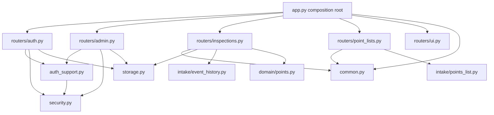

# Data Structures and Dependencies

## Primary Data Structures (Storage Models)
Defined in `src/alarm_inspection/storage.py`.

- `Inspection`
- `User`
- `UserSession`
- `AppSetting`
- `PanelType`
- `InspectionTask`
- `InspectionChecklistDecision`
- `PointList`
- `SourceFile`
- `PointListDecision`
- `PointListEventDate`
- `PointListPendingEventDate`

These models are the persistence contract and should be treated as stable unless a migration plan is included.

## Optional PDF integration records (P2)

`integrations/pdf_models.py` defines separate `PdfBase` metadata: `PdfIntegration`, `PdfIntegrationVersion`, `InspectionFormDecision`, `PdfExportArtifact`, `PdfIntegrationAuditEntry`, plus the singleton `PdfSchemaState`. Existing model columns are unchanged. With `INSPECTIONS_PDF_INTEGRATIONS_ENABLED` absent/false, `open_store()` does not import these models or create their tables. Explicit initialization creates only additive records and seeds the two disabled integration identities.

Schema version 1 uses new foreign keys/checks and SQLite/PostgreSQL triggers for append-only decisions/audit, immutable published versions and sealed artifacts, and valid published active-version references. Repository helpers validate legacy inspection/panel/actor references; actor IDs remain stored strings so physical user deletion retains audit identity and current deletion behavior. Private blobs are immutable and hash-checked. See [P2 schema, failure and migration policy](PDF_INTEGRATION_P2_REPORT.md).

`PointListDecision.device_highlighted` stores the optional Device Type cell highlight, independently of acceptance and event mappings. Startup adds this Boolean column with a false default for existing databases; existing decisions and uploads remain intact. A scoped PATCH endpoint updates only accepted, undeleted points.

`PointListDecision.device_event_missing` records the warning assessed after a successful upload. Startup adds this Boolean column with a false default; the new `point_list_pending_event_dates` table uses inspection, Points List, and address as its key. Pending matches are cumulative shared evidence, separate from accepted mappings. No existing accepted mappings are changed. Event uploads retain unique storage paths even when filenames repeat.

Checklist definitions include `input_type` and `options_json`; decision history includes the type, captured `value`, and a snapshot of choices as well as the legacy completion flag. Startup adds these columns with checkbox/empty defaults to preserve existing checked values. Text values are limited to 2000 characters; dropdowns allow 1–50 distinct nonempty choices of up to 120 characters. Removing a choice never erases historical answers. New selections are validated against current choices in `domain/checklist.py`. Checkbox answers use the existing `value` column for Yes, No, NA, or an empty (unanswered) value; `completed` means an answer was provided, including No or NA. New checkbox decisions snapshot all three choices. Existing Boolean-only decisions remain untouched: reads display a checked decision as Yes and an unchecked decision as unanswered. Existing task definitions automatically use the three-box interface; no schema or history rewrite is required. Legacy Boolean updates remain supported for older clients.

## API Module Dependency Map

## Feature Ownership
- `routers/auth.py`: login/session/profile/reset-password endpoints.
- `routers/admin.py`: user and default-password admin operations.
- `routers/inspections.py`: inspection CRUD, event-history upload, event-date save/clear.
- `routers/inspection_tasks.py`: administrator task definitions and auditable per-inspection checklist decisions.
- `routers/point_lists.py`: points-list preview parser endpoint.
- `routers/ui.py`: homepage and review script delivery.

## Shared Helper Ownership
- `security.py`: password hashing and verification primitives.
- `auth_support.py`: auth/admin helper operations using persisted settings and sessions.
- `common.py`: upload path, coercion, date/time parsing, and event kind helpers.

## Invariants
1. Approved point decisions are never silently replaced.
2. Event-date mappings are additive unless explicitly cleared.
3. Mapping accepts only allowed accepted points for the selected points list.
4. Review completion requires all rows accepted or deleted.
